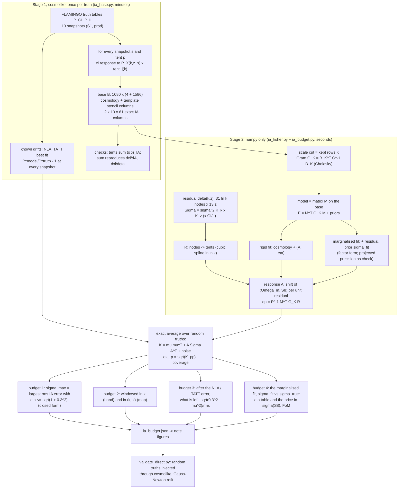

# v9: the IA error budget with the Fisher machinery of the bias-prior notes

This folder carries the method of two lssty1xdesi notes over to the IA
error budget of Roman cosmic shear (xi_+-):

- `notes/correlated_bias_prior_v2`: a correlated Gaussian prior on per-bin
  residuals, with the free level and line projected out; random truths;
  the exact accuracy score eta = sqrt(<chi2>/n_dof) and the coverage.
- `notes/fisher_machinery`: one base of derivative columns per elementary
  knob, every model a matrix M on it (D = B M), one Gram matrix
  G_K = B_K^T C_KK^-1 B_K per scale cut, and everything downstream (Fisher
  matrices, shifts, eta) as products of small matrices.

## The dictionary

| bias-prior notes | this folder |
|---|---|
| data: DESI C_ell^gg band powers | Roman xi_+- (1080 points), example1 covariance |
| elementary knob: b1, b2, ... of one thin bin | the fractional error of P_GI or P_II on one ln k tent (61 tents, 0.01 to 10 h/Mpc) at one snapshot (13 snapshots): 2 x 13 x 61 = 1586 knobs |
| base B: one derivative column per knob | the xi response to each knob; exact, because xi is linear in the IA tables |
| per-bin linear bias residual eps_i, kernel sigma_g^2 exp(-\|dz\|/L) | the IA error delta_X(k, z) at 31 ln k nodes x 13 snapshots, kernel sigma^2 K_k(ln k) K_z(z), splined in ln k onto the tents |
| free level B_g and tilt s_g of a group | free IA amplitude A and evolution eta of the truth-as-model template (GI ~ a, II ~ a^2, a = A ((1+z)/1.62)^eta) |
| projected precision P = Q - QU(U^TQU)^-1 U^TQ | the same, with U the two template directions (1, ln x) in delta space (GI weight 1, II weight 2) |
| growth-tied prior (no residual freedom) | the rigid template fit: cosmology + (A, eta), no residual |
| correlated prior (residual marginalised) | the marginalised fit: template + residual with a Gaussian prior of width sigma_fit |
| known drift (conserved population, BGS flux limit) | the error of the NLA or TATT best fit against the FLAMINGO truth |
| random truth: drift + residual ~ N(0, Sigma) | NLA/TATT error (or none) + residual ~ N(0, sigma_true^2 K) |
| scored parameters (w0, wa), Omega_m, A_s | Omega_m and S8 (and the pair) |
| eta = sqrt(<chi2>/n_dof), coverage | the same, in closed form |
| shift reference 0.3 sigma | the budget criterion: eta <= sqrt(1 + 0.3^2), i.e. rms shift <= 0.3 sigma |

## The flow

## The budget, in one formula

For the rigid fit, a random IA error delta ~ N(mu_delta, sigma^2 K) moves
parameter p (Omega_m or S8, in units of its marginalised error) by
z_p = a_p . delta, with a_p the row of the response. Averaged over the
random truths and the data noise, exactly,

    <chi2_p> = eta_p^2 = mu_p^2 + sigma^2 a_p K a_p^T + 1,

with mu_p = a_p . mu_delta the shift of the known drift and 1 the noise. The
budget is the largest sigma with eta_p <= sqrt(1 + 0.3^2) for both p:

    sigma_max = min_p sqrt(0.3^2 - mu_p^2) / sqrt(a_p K a_p^T).

`box95`, the criterion of v8 (95% of the errors keep both |z_p| < 0.3), is
computed exactly as well (bivariate normal, no Monte Carlo), and with the
squared-exponential kernel, the same error at every z (L_z = inf) and no
window it must reproduce v8's eps_95 (`correlated_budget.json`).

## Files

| file | what | needs cosmolike |
|---|---|---|
| `ia_fisher.py` | the library: grids, kernels, Gram, fits, responses, eta, coverage, budgets | no |
| `ia_base.py` | stage 1: the base and the drifts, `ia_base_<truth>.npz`, `ia_base_common.npz` | yes |
| `ia_budget.py` | stage 2: every budget, `ia_budget.json`, `ia_budget_log.txt` | no |
| `verify_ia_fisher.py` | the identities on toys, and on the base when it exists | no |
| `validate_direct.py` | random truths through cosmolike, refitted; `validate_direct.json` | yes |

## How to run (in order)

    PY=~/cocoa/Cocoa/.local/bin/python
    SO=<cocoa so dir>; DATA=<cocoa_roman_real/data>     # as for v8
    $PY verify_ia_fisher.py                    # toys, seconds
    $PY ia_base.py $SO $DATA                   # stage 1, about 5 to 30 min per truth
    $PY verify_ia_fisher.py                    # again: now also checks the base
    $PY ia_budget.py                           # stage 2, a few minutes
    $PY validate_direct.py $SO $DATA           # about 20 refits with CAMB

Every number of the budget comes from `ia_budget.json`; nothing in stage 2
evaluates cosmolike.

## 3x2pt: galaxy-galaxy lensing

The same knobs on the full Roman 3x2pt vector (2115 points: xi_+-, gamma_t,
w). IA enters gamma_t through the GI term b_i P_dE, so one P_dE error moves
xi_+- and gamma_t together; II enters xi_+- alone; w has no IA. The rigid
fit frees the 8 linear biases (flat) besides Omega_m, A_s, A, eta
(`ia_fisher.py` takes any number of rigid parameters from the base). The
shipped example1 3x2pt covariance is not positive definite, so every 3x2pt
number uses the Gaussian one of `../cocoa/cov3x2.py`
(`analysis/cov3x2_gauss_d3a.npy`, not committed: 35 MB, 10 s to rebuild).

| file | what | cosmolike |
|---|---|---|
| `ia_base_3x2.py` | the 3x2pt base and the masks per probe; `ia_base_3x2_<truth>.npz`, `ia_base_3x2_common.npz` | yes |
| `fits_3x2.py` | NLA and TATT fitted to the 3x2pt vector at each band cut; `fits_3x2.json` | yes |
| `ia_budget_3x2.py` | global budget, bands, model drifts; regression on `ia_budget.json`; `ia_budget_3x2.json` | no |
| `scale_cut_scan_3x2.py` | the GGL cut at K0_cs = 0.2, every pair and sources behind lenses; `scale_cut_scan_3x2.json` | yes |

    (cd ../cocoa && $PY -c "import numpy as np, runpy, sys; np.trapezoid = np.trapz; \
        sys.argv = ['cov3x2.py', '$DATA']; runpy.run_path('cov3x2.py', run_name='__main__')")
    $PY ia_base_3x2.py $SO $DATA               # about 3 min for both truths
    $PY fits_3x2.py $SO $DATA --truths prod    # about 6 min
    $PY ia_budget_3x2.py                       # about 2 min
    $PY scale_cut_scan_3x2.py $SO $DATA        # about 22 min for both truths

(The numpy shim is needed only where numpy is older than 2.0.)
